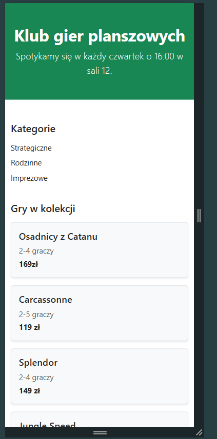
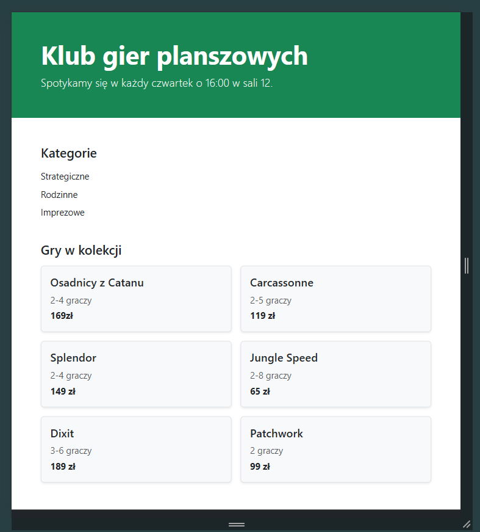
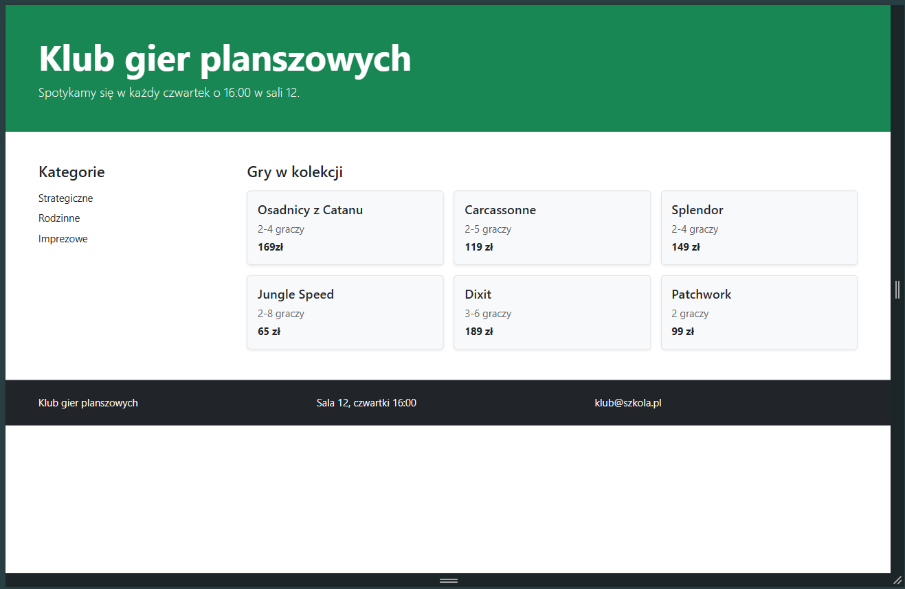

# Klub gier planszowych

Responsywna strona szkolnego klubu gier planszowych przygotowana w HTML i Bootstrapie 5.3. Zawiera informacje o spotkaniach, kategorie i kolekcję sześciu gier.

## Uruchomienie

1. Mając zainstalowany Node.js, otwórz terminal w katalogu `strony/mb08-klub-gier` i uruchom polecenie.

   ```powershell
   npm install
   ```

   Polecenie instaluje Bootstrap w katalogu `node_modules`, który jest pomijany przez Git.

2. Kliknij dwukrotnie plik `index.html`, aby otworzyć stronę w przeglądarce.

## Struktura projektu

```text
mb08-klub-gier/
├── .gitignore         reguła pomijania node_modules
├── README.md          dokumentacja projektu
├── index.html         strona klubu i dane gier
├── package.json       konfiguracja projektu i zależności
├── package-lock.json  zapis dokładnych wersji zależności
└── docs/
    └── zrzuty/
        ├── waski.png
        ├── sredni.png
        └── szeroki.png
```

## Użyte klasy

| Element | Klasy | Po co |
| --- | --- | --- |
| Nagłówek strony | `bg-success text-white py-5` | Zielone tło, biały tekst i duże odstępy w pionie. |
| Kontener treści | `container` | Wyśrodkowuje treść i ogranicza jej szerokość na większych ekranach. |
| Wyrównanie tekstu w nagłówku i stopce | `text-center text-md-start` | Wyśrodkowuje tekst poniżej 768 px i wyrównuje go do lewej od 768 px. |
| Układ kategorii i kolekcji | `col-12 col-lg-3` i `col-12 col-lg-9` | Poniżej 992 px kategorie są nad kolekcją. Od 992 px zajmują 3 z 12 kolumn siatki, a kolekcja pozostałe 9. |
| Odstępy w siatce | `row g-4` i `row g-3` | Oddzielają kategorie od kolekcji i dają odstępy między kartami. |
| Kolumny kart | `col-12 col-md-6 col-xl-4` | Pokazują jedną kartę w rzędzie poniżej 768 px, dwie od 768 px i trzy od 1200 px. |
| Wygląd kart | `border rounded p-3 h-100 bg-body-tertiary shadow-sm` | Dodają ramkę, zaokrąglenie, odstępy wewnętrzne, jasne tło i delikatny cień. `h-100` wyrównuje wysokość kart w rzędzie. |
| Kolumny stopki | `col-md-4` | Poniżej 768 px napisy są pod sobą. Od 768 px każdy napis zajmuje jedną trzecią szerokości rzędu. |

## Zrzuty ekranu



*Widok wąski (400 px). Nagłówek jest wyśrodkowany, kategorie są nad kolekcją, a karty układają się w jednej kolumnie.*



*Widok średni (800 px). Kategorie są nad kolekcją, a karty układają się w dwóch kolumnach.*



*Widok szeroki (1400 px). Kategorie są po lewej, karty po prawej w trzech kolumnach, a stopka mieści się w jednym rzędzie.*

## Autor

Emix999
